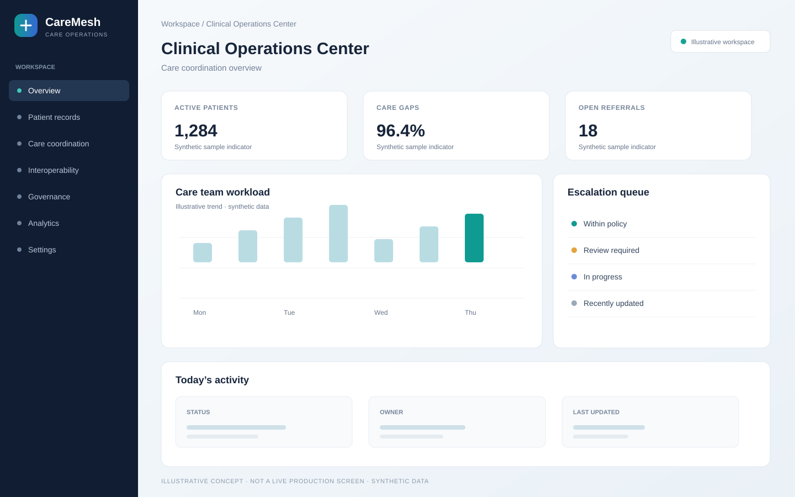
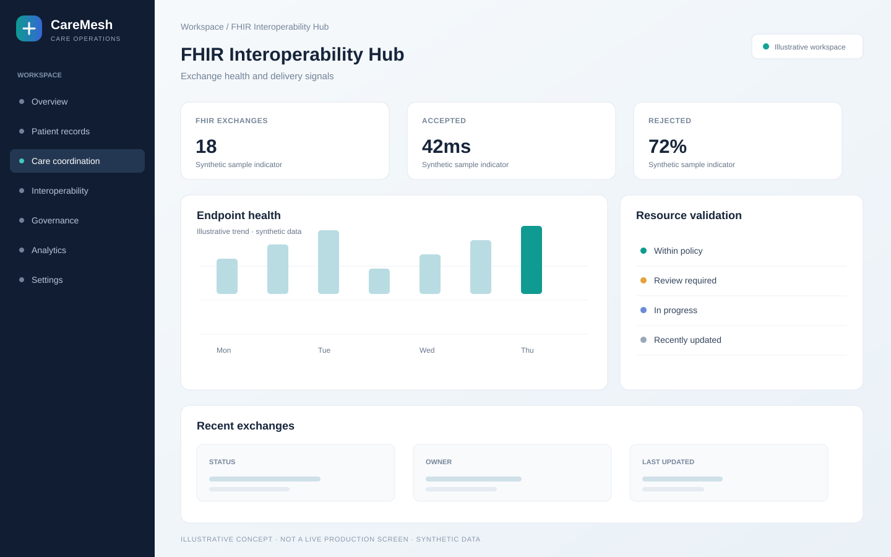
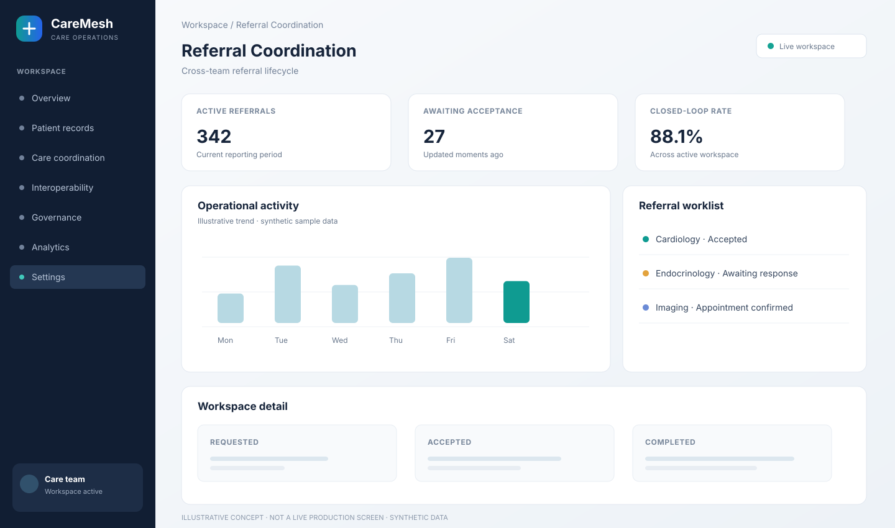
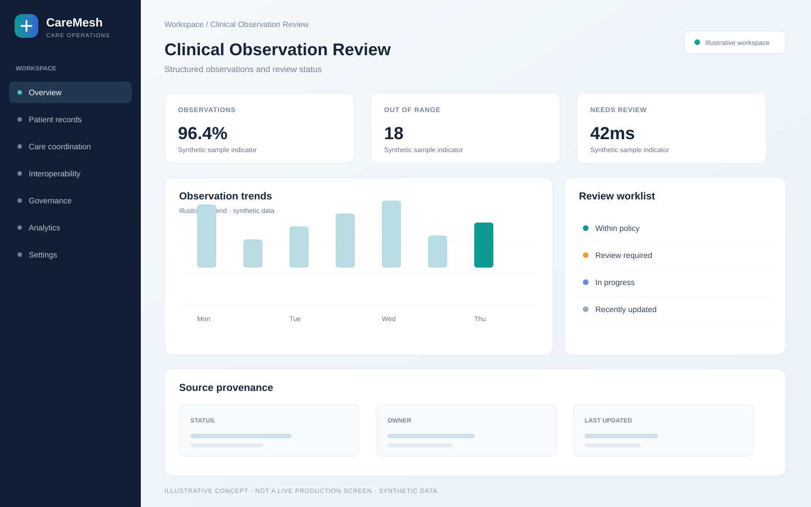
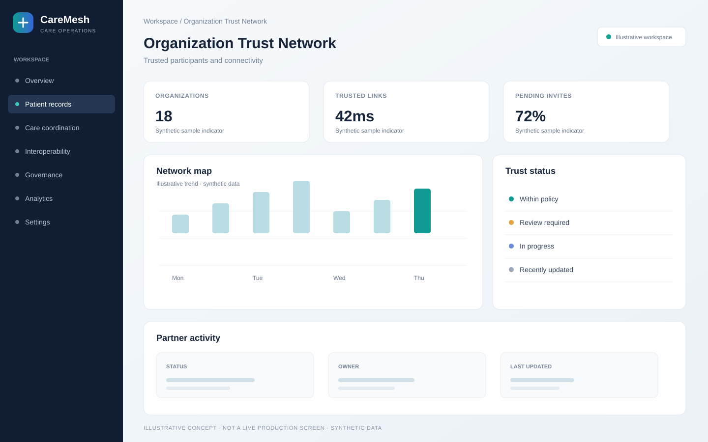
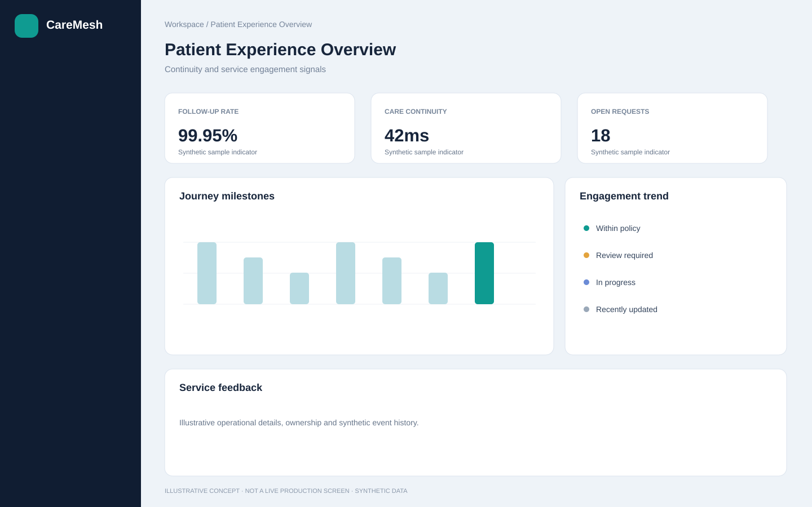

# CareMesh

**Enterprise Healthcare Interoperability & Care Coordination Platform**

> Connect authorized clinical context, care teams and patient journeys through privacy-aware, auditable workflows.

CareMesh is a modular healthcare platform project focused on tenant-aware clinical workflows, consent and purpose-of-use governance, FHIR-oriented interoperability, and accountable care coordination.

## 1. Project status

**Main branch: engineering foundation.** Feature work is developed in stacked pull requests and should be treated as in progress until merged into main. This is a portfolio engineering project—not a clinical system, certified health IT product, or production exchange network.

- Foundation and engineering guardrails: repository baseline.
- Consent-aware FHIR Patient, Observation and Condition exchange: active feature-branch work.
- Care-gap coordination, SLA reporting and clinical audit: feature-branch work.
- External partner certification, terminology conformance and production integrations: not claimed.

Use synthetic data only. Never upload real patient information, PHI, credentials or production exports.

## 2. Product problem and value

Clinical context is fragmented across organizations and systems. CareMesh explores safer, more useful exchange through organization-scoped patient context, explicit consent and purpose checks, bounded FHIR resource mapping, care-gap follow-up, referrals, attributable audit evidence and integration health.

## 3. Capability map

| Domain | Capability direction | Delivery boundary |
| --- | --- | --- |
| Identity & tenancy | Organization membership and role-scoped access | Server-side authorization required |
| Patient context | Patient identity and longitudinal record | Synthetic data only |
| Consent governance | Purpose-aware access and expiry checks | Not a legal consent determination |
| FHIR interoperability | Read-only R4 Patient, Observation and Condition slices | Partial subsets; not full conformance |
| Care coordination | Care gaps, follow-up queue and SLA signals | Operational workflow foundation |
| Audit & provenance | Actor, purpose, resource and correlation metadata | Avoid PHI in audit payloads |
| Integrations | Partner adapters, retries and delivery monitoring | No partner certification claimed |

## 4. Technology and architecture

TypeScript monorepo direction: React/Vite web, Node.js/Express API, MongoDB/Mongoose persistence, Zod/shared contracts, automated tests and GitHub Actions.

1. Derive tenant context from authenticated server-side identity.
2. Deny access by default and authorize every protected resource.
3. Enforce consent and purpose before disclosure.
4. Bound pagination, query size and FHIR Bundle responses.
5. Preserve provenance and audit sensitive access decisions.
6. Separate UI permissions from API authorization.
7. Treat external payloads as untrusted input.

## 5. Local development

Prerequisites: Node.js 22+, npm 10+, Docker and local MongoDB.

    npm ci
    npm run dev
    npm run typecheck
    npm test
    npm run build

Configure local environment files from .env.example templates. Never commit secrets. Use synthetic fixtures only; follow the selected branch's app-level setup guide.

## 6. Security, privacy and responsible use

- No real patient data in development, CI, screenshots or demos.
- No claim of HIPAA, GDPR, ONC certification, TEFCA participation or FHIR conformance.
- Consent logic is application authorization support, not legal advice or proof of lawful basis.
- Use minimum-necessary data, strict tenant scoping, explicit purpose and attributable audit events.
- Production use requires jurisdiction-specific legal review, clinical safety assessment, threat modelling, penetration testing, disaster recovery and partner conformance testing.

## 7. Standards-aware roadmap

- FHIR R4 validation and profile-aware exchange with explicit versioning.
- US Core profile mapping and terminology-service integration where relevant.
- SMART on FHIR / OAuth 2.0 patterns and least-privilege scopes.
- Idempotent integration jobs, retry/dead-letter handling and delivery observability.
- Consent lifecycle history, revocation propagation and auditable purpose decisions.
- Accessibility, end-to-end testing and operational runbooks.

Reference: [ONC 2026 approved SVAP standards](https://healthit.gov/blog/standards/advancements-in-health-it-oncs-2026-approved-svap-standards/) includes USCDI v6 and updated FHIR-based Da Vinci implementation guides. This is a roadmap reference, not a certification claim.

## 8. Illustrative dashboard gallery

The 12 visuals below are **illustrative SVG dashboard concepts**, not screenshots from a running production system. All values and activity are synthetic. The single-column sequence communicates the intended operator experience; it does not prove that every depicted module is implemented.

### 01. Clinical Operations Center
Care-team workload, active care gaps and operational exceptions.

### 02. Patient Longitudinal Record
Consent-aware encounters, conditions, observations and source provenance.

### 03. FHIR Interoperability Hub
Resource throughput, validation outcomes and partner endpoint health.

### 04. Consent & Purpose Controls
Active grants, expiry monitoring, purpose policies and access decisions.

### 05. Care-Gap Follow-up Queue
Prioritized overdue gaps, ownership, due dates and follow-up accountability.

### 06. SLA & Quality Intelligence
Timeliness, escalation patterns and care coordination service levels.

### 07. Referral Coordination
Closed-loop referral intake, handoff status, partner response and completion.

### 08. Clinical Observation Review
Observation trends, out-of-range signals and source context.

### 09. Organization Trust Network
Participating organizations, trust relationships and onboarding state.

### 10. Audit & Access Explorer
Access decisions, actors, purpose and security review evidence.

### 11. Integration Reliability
API availability, latency, retry backlog and partner delivery health.

### 12. Patient Experience Overview
Follow-up continuity, engagement signals and service feedback.

## 9. Engineering quality gates

Validate the exact commit with typecheck, unit/integration tests, production build, dependency audit, CodeQL, secret scanning, tenant-isolation and consent-denial tests, FHIR mapping tests, and workflow-permission review. A green workflow is evidence for that commit and workflow only—not proof of clinical safety or regulatory compliance.

## 10. Contribution and license

See [CONTRIBUTING.md](CONTRIBUTING.md) and [SECURITY.md](SECURITY.md). No open-source license is applied unless a license file is added; otherwise all rights are reserved.
