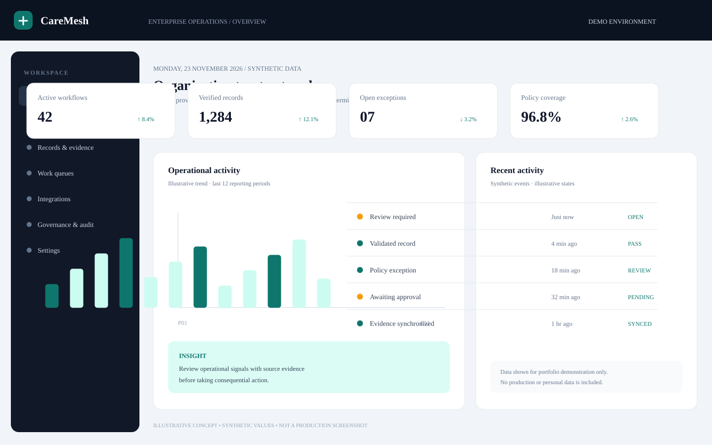

# CareMesh

**Enterprise Healthcare Interoperability & Care Coordination Platform**

> A privacy-first foundation for trusted health information exchange and coordinated care across authorized organizations.

[](https://github.com/matiur25580/CareMesh-Enterprise-Healthcare-Interoperability-Care-Coordination-Platform/actions)

## 1. Product vision

CareMesh is being developed to connect healthcare organizations through consent-aware information exchange, accountable care coordination and standards-based interoperability. It aims to reduce fragmented handoffs while preserving patient privacy, organizational boundaries and attributable access.

## 2. Project status and responsible use

**Status: active portfolio development; not a production clinical system.** The repository contains foundation and milestone work, but the default branch and each feature branch may differ. The dashboard gallery below is illustrative and does not prove that every depicted workflow is implemented.

- Do not use this project to make clinical decisions or coordinate real patient care.
- Do not upload real patient information, PHI, credentials or production exports.
- No regulatory compliance, clinical validation, security certification or FHIR conformance is claimed.
- Use synthetic data exclusively for development and demonstrations.

## 3. Product domains

- **Organization trust:** provider directory, facilities and explicit inter-organization relationships.
- **Identity and access:** authenticated identity, role-aware permissions and tenant isolation.
- **Patient identity:** identity resolution and carefully governed record discovery.
- **Consent and purpose:** consent lifecycle, permitted purpose, validity windows and authorization decisions.
- **Interoperability:** versioned FHIR-oriented exchange contracts and validated adapters.
- **Care coordination:** referrals, care gaps, tasks and accountable handoffs.
- **Audit and provenance:** attributable access events, change history and evidence references.
- **Operations:** data-quality monitoring, integration health and operational metrics.

These domains describe the product direction; implementation status should be verified against the relevant source code, tests and release branch.

## 4. Architecture and engineering principles

1. Deny by default; enforce authorization on the server for every protected resource.
2. Derive tenant and organization context from trusted authentication, never from client-supplied identifiers alone.
3. Apply consent and purpose-of-use checks at the service boundary.
4. Minimize sensitive data in logs, traces, analytics and error responses.
5. Validate external messages and preserve source provenance.
6. Make retries bounded and idempotent where exchange operations require them.
7. Use synthetic fixtures and test data; never commit PHI.
8. Keep interoperability adapters behind explicit contracts and version boundaries.

## 5. Technology and repository orientation

The platform is organized around a TypeScript web/API architecture, with healthcare domain services, persistence, shared contracts and documentation. Refer to the package manifests and architecture documents on the branch being used for the exact dependency versions and runnable commands.

Common areas include `apps/api`, `apps/web`, `packages`, `docs` and `.github/workflows` where present.

## 6. Local development

1. Install the Node.js and package-manager versions declared by the repository.
2. Review the available `.env.example` files and configure local-only values.
3. Start the local database and identity dependencies documented for the selected milestone.
4. Install dependencies using the committed lockfile and the package manager specified by the workspace.
5. Run the scripts declared in the root and application `package.json` files.

Never place production secrets in environment files committed to Git. If a command is not defined by the checked-out branch, do not assume it exists.

## 7. Quality, security and delivery

- Run type checking, unit/integration tests and production builds before proposing a merge.
- Test tenant isolation, consent denial, purpose mismatch, expired consent and audit attribution.
- Use CodeQL, secret scanning and dependency auditing in CI where configured.
- Review workflow permissions, dependency pinning and artifact provenance.
- Maintain threat models, data-retention decisions, backup/restore procedures and incident response guidance as the system matures.

## 8. Illustrative dashboard gallery

The 12 SVGs are **illustrative dashboard concepts**, not screenshots from a running product. Every value is synthetic. The single-column presentation is intended for readable full-width review.

### 01 — Care coordination command center
A high-level view of cross-organization care activity, open handoffs and operational signals.


### 02 — Patient identity resolution
A concept for identity-match review, confidence indicators and careful duplicate-resolution workflows.


### 03 — Consent and purpose governance
A view of consent state, permitted purposes, expiry windows and review exceptions.


### 04 — FHIR interoperability hub
A conceptual exchange monitor for resource validation, partner endpoints and integration outcomes.


### 05 — Referral management workspace
A workflow concept for referral ownership, receiving organizations and handoff progress.


### 06 — Clinical access audit
An attributable event view for sensitive-record access, policy decisions and audit review.


### 07 — Care gap intelligence
A synthetic prioritization view for care gaps and follow-up coordination.


### 08 — Organization trust network
A view of provider relationships, exchange permissions and partner readiness.


### 09 — Patient record timeline
A synthetic timeline concept for encounters, observations and transitions of care.


### 10 — Interoperability data quality
A quality workspace for validation exceptions, terminology mapping and completeness signals.


### 11 — Security and privacy operations
A governance view for access anomalies, consent exceptions and privacy review status.


### 12 — Referral performance analytics
A reporting concept for referral turnaround, closure rates and cross-organization performance.


## 9. Documentation and contribution

Start with the architecture and security documentation under `docs/`, then review [SECURITY.md](SECURITY.md) and [CONTRIBUTING.md](CONTRIBUTING.md). Keep pull requests focused, tested and explicit about implementation status and limitations.

## 10. Roadmap themes

- Strengthen tenant-boundary and consent integration tests.
- Expand FHIR resource contracts and interoperability validation.
- Improve referral and care-coordination workflow observability.
- Add operational runbooks, resilient integration patterns and accessibility coverage.
- Establish a formal privacy, threat-model and clinical-safety review before any real-world pilot.

## 11. License

No open-source license is applied unless a license file is present in the repository. All rights are otherwise reserved.

## 9. Runnable web dashboard (synthetic-data milestone)

The React/Vite dashboard now lives in `apps/web`. It provides tenant login, API health visibility and a consent-purpose simulator. The evaluator accepts only a synthetic consent snapshot and returns a rule-based demonstration result. It does not read persisted consent records, authorize EHR access, exchange FHIR resources, or support clinical workflows.

Run the API and web development server in separate terminals:

```bash
npm install
npm run dev
npm run dev:web
```

Open `http://localhost:5174`. The Vite server proxies `/api` requests to the local API on port 4100.

For a production-style local build:

```bash
npm run build
npm start
```

The API serves `apps/web/dist` at its root when that build exists. Access tokens are held in browser memory and are cleared on refresh/sign-out. Provision a synthetic-data-only test account with the operator-only `npm run user:create` command.

## 10. Synthetic consent decision audit history

Every successful consent simulation is recorded in a tenant-scoped audit collection with the actor account, requested purpose, supplied consent status, decision, reason codes and timestamp. No subject reference, patient identifier or clinical payload is stored in this history. Authorized users can view the latest 25 decisions in the dashboard. These records document simulator activity only; they are not a legal consent ledger and do not authorize EHR or clinical access.

## 11. Automated validation

Run the API and frontend test suite with:

```bash
npm test
npm run typecheck
npm run build
```

The tests cover consent decision rules, strict input validation, synthetic audit recording, tenant-scoped history queries, JWT account revalidation, role authorization, and dashboard safety messaging. GitHub Actions runs tests, type checks, and production builds on pushes and pull requests.

**Safety boundary:** keep this project synthetic-data-only. Do not enter patient information or connect production clinical systems until privacy, security, consent provenance, access controls, audit integrity, threat modelling and legal/compliance reviews have been completed.


## Container workflow (synthetic data only)

A local Docker Compose stack runs the API/web application with MongoDB. This is for local development and synthetic demonstrations only; it is not a production clinical deployment.

```bash
# Create a local-only secret (keep .env out of version control).
printf 'JWT_SECRET=%s\n' "$(openssl rand -base64 48)" > .env

docker compose up --build -d
docker compose ps
docker compose logs -f app
```

Open http://localhost:4100. The API readiness endpoint is available at `/api/health/ready`; Compose waits for MongoDB to pass its health check before starting the app. MongoDB is reachable only on the Compose network and its data is stored in a named volume. Stop the stack with `docker compose down`; this preserves the database volume.

The image uses a multi-stage Node build and runs as the unprivileged `node` user. This setup does not establish healthcare regulatory compliance, clinical safety or production readiness. Keep all data synthetic: never connect real patient records, PHI or production clinical systems. A future production design requires privacy/legal review, threat modelling, managed authenticated database services with TLS, managed secrets, strict network controls, backups and audited operational controls.
