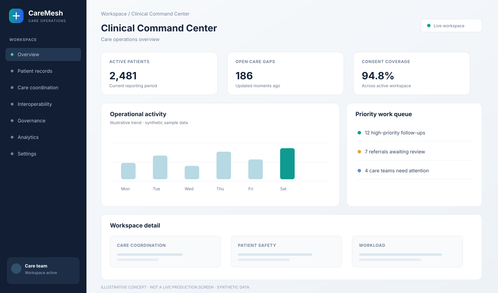
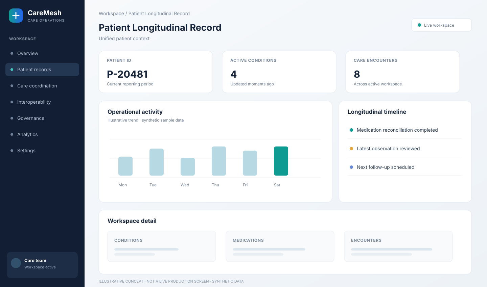
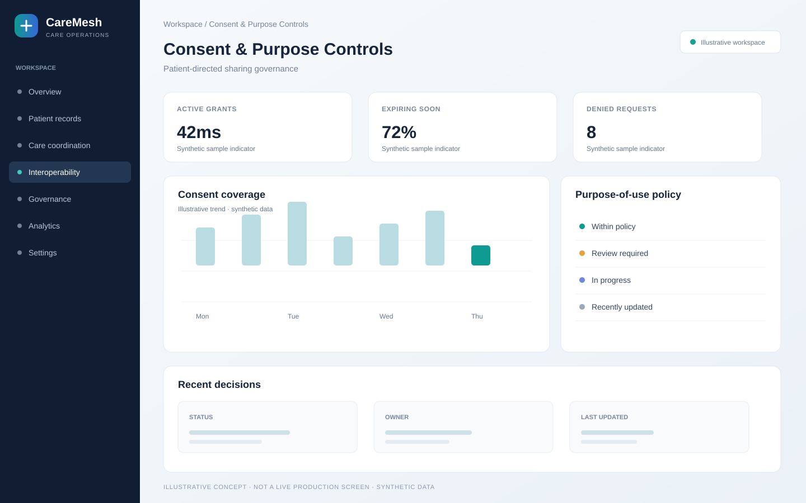
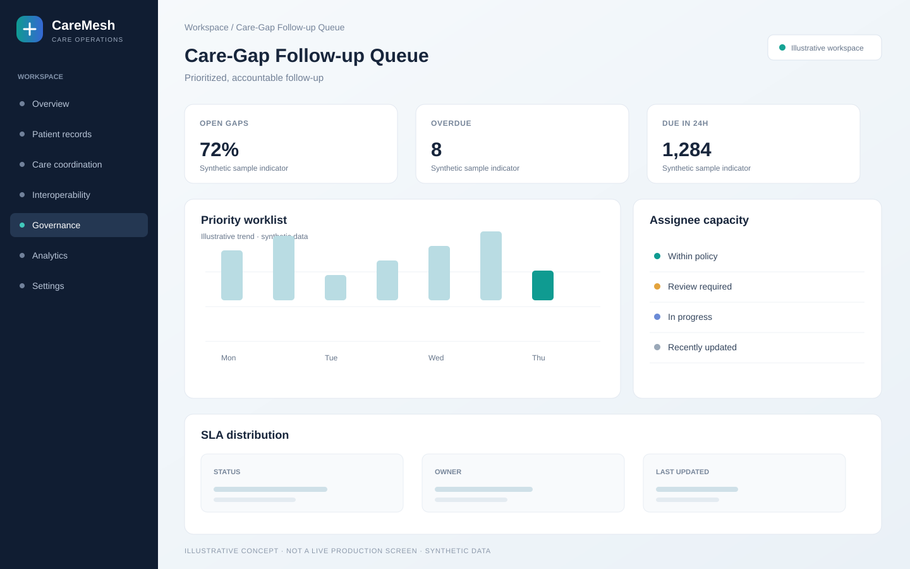
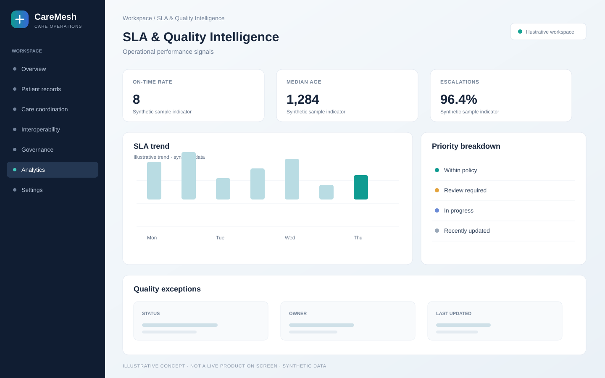
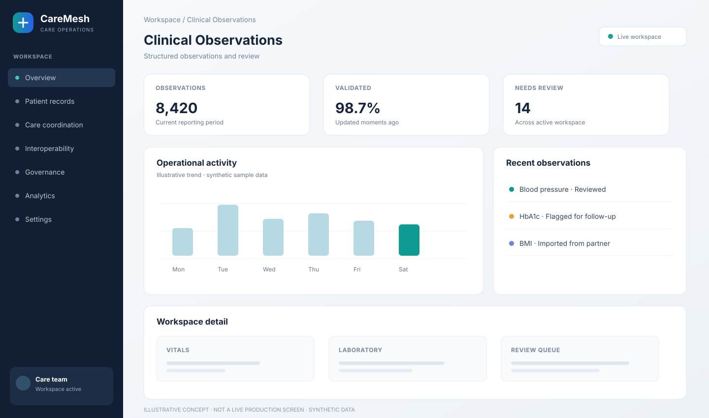
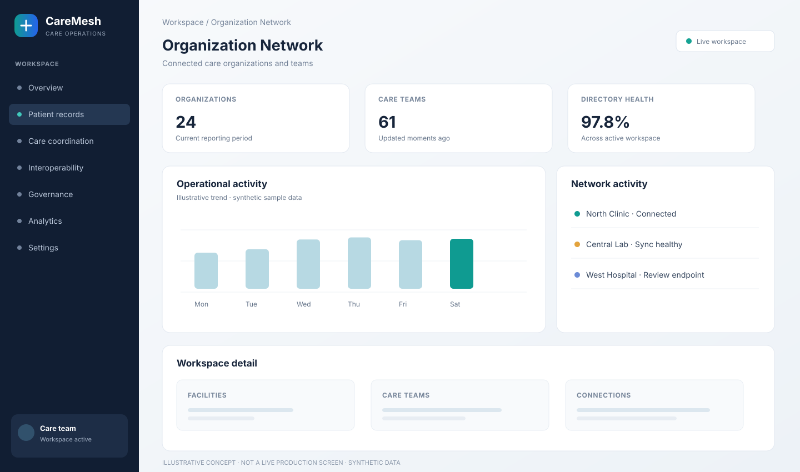
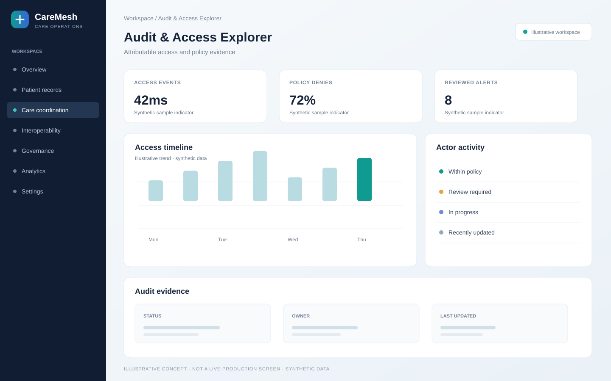
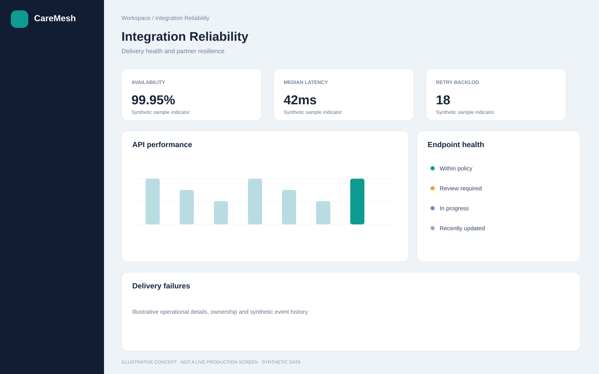

# CareMesh

**Enterprise Healthcare Interoperability & Care Coordination Platform**

> Connect authorized clinical context, care teams and patient journeys with privacy-aware coordination.



## 1. Product overview

CareMesh is an enterprise-oriented platform built around secure, auditable workflows and clear domain boundaries. It is developed incrementally as a modular application rather than presenting planned integrations as already operational.

## 2. Current implementation

- Tenant-aware patient registry and clinical record workflows
- Consent- and purpose-aware access controls with audit trails
- FHIR-oriented interoperability foundations and exchange documentation
- Care-gap follow-up queue with priority, due dates, ownership and resolution notes
- Aggregate care-gap SLA summary with overdue, due-soon and on-track indicators
- Patient, organization and clinical workspace foundations

### Implementation status and boundaries

The repository includes implemented API and web foundations, consent-aware patient workflows, care-gap operations and SLA reporting. External FHIR partner certification, production clinical integrations and regulatory validation require separate implementation and review.

## 3. Technology stack

React 19, TypeScript, Vite, Node.js, Express 5, MongoDB, Mongoose, Zod, Vitest and npm workspaces

## 4. Architecture and engineering principles

- **Web client:** responsive React application; presentation logic is separate from API authorization.
- **API:** versioned HTTP boundary with input validation, authentication and domain-level authorization.
- **Persistence:** MongoDB/Mongoose with tenant-aware query patterns where applicable.
- **Contracts:** typed request/response validation at service boundaries.
- **Operations:** container-friendly local development, automated CI, CodeQL, secret scanning and dependency auditing.
- **Security:** least privilege, bounded input, auditability, secret-free source control and explicit trust boundaries.

## 5. Repository structure

```text
apps/
  api/                 API, domain modules, routes and persistence
  web/                 React operator workspace
packages/              Shared contracts / validation (where present)
docs/                  Architecture, security, product and runbooks
.github/workflows/     CI, CodeQL, secret scan and dependency audit
```

## 6. Local development

### Prerequisites

- Node.js 22 or newer.
- npm 10 or newer.
- Docker with Docker Compose and MongoDB; a replica set or sharded deployment is required for transaction-backed paths.

### Install and run

```bash
npm install
npm run dev
```

Copy the relevant `.env.example` files to local environment files and configure MongoDB, authentication secrets and the web API origin as described in app-level setup docs. Never commit real credentials. The web app commonly uses `http://localhost:5173`; the API commonly uses `http://localhost:4000`.

### Quality checks

```bash
npm run typecheck
npm test
npm run build
```

Run only scripts defined in the corresponding package manifests; not every package exposes every command.

## 7. Security and data handling

- Never commit API keys, signing keys, database credentials, patient/customer data or production exports.
- Derive tenant, organization and jurisdiction identifiers from authenticated server-side context.
- Validate and bound external input and provider responses.
- Keep audit records free of secrets and unnecessary sensitive payloads.
- Treat imported SBOMs, attestations, clinical records, sensor data and partner declarations as untrusted input.
- Use synthetic data for local development, tests and demonstrations.
- Complete threat modelling, privacy assessment, penetration testing, backup/restore exercises and operational readiness reviews before production use.

## 8. Illustrative dashboard gallery

The following 12 screens are **illustrative vector dashboard concepts**, created for product communication and portfolio presentation. They are not screenshots captured from a running deployment, do not prove that every depicted module is implemented, and contain synthetic example values only. The images are arranged in a single vertical column for full-width inspection.

### 01. Clinical command center

Care operations • Patient access • Care coordination. This concept view illustrates a representative operator workflow; values are synthetic and do not represent live production telemetry.


### 02. Patient longitudinal record

Care operations • Patient access • Care coordination. This concept view illustrates a representative operator workflow; values are synthetic and do not represent live production telemetry.



### 03. FHIR interoperability hub

Care operations • Patient access • Care coordination. This concept view illustrates a representative operator workflow; values are synthetic and do not represent live production telemetry.


### 04. Consent & purpose controls

Care operations • Patient access • Care coordination. This concept view illustrates a representative operator workflow; values are synthetic and do not represent live production telemetry.



### 05. Care-gap follow-up queue

Care operations • Patient access • Care coordination. This concept view illustrates a representative operator workflow; values are synthetic and do not represent live production telemetry.



### 06. SLA & quality intelligence

Care operations • Patient access • Care coordination. This concept view illustrates a representative operator workflow; values are synthetic and do not represent live production telemetry.



### 07. Referral coordination

Care operations • Patient access • Care coordination. This concept view illustrates a representative operator workflow; values are synthetic and do not represent live production telemetry.


### 08. Clinical observations

Care operations • Patient access • Care coordination. This concept view illustrates a representative operator workflow; values are synthetic and do not represent live production telemetry.



### 09. Organization network

Care operations • Patient access • Care coordination. This concept view illustrates a representative operator workflow; values are synthetic and do not represent live production telemetry.



### 10. Audit & access explorer

Care operations • Patient access • Care coordination. This concept view illustrates a representative operator workflow; values are synthetic and do not represent live production telemetry.



### 11. Integration reliability

Care operations • Patient access • Care coordination. This concept view illustrates a representative operator workflow; values are synthetic and do not represent live production telemetry.



### 12. Patient experience overview

Care operations • Patient access • Care coordination. This concept view illustrates a representative operator workflow; values are synthetic and do not represent live production telemetry.


## 9. Engineering quality and delivery

- Automated build, type-check and test workflows are maintained in GitHub Actions.
- CodeQL and secret scanning provide static security and credential-leak checks.
- Dependency auditing runs against the committed lockfile on pull requests and scheduled checks. The latest feature-branch audit reports zero known vulnerabilities; continue monitoring for newly disclosed advisories.
- Changes are developed on isolated feature branches and reviewed through draft pull requests.
- Transaction-backed paths require MongoDB replica-set or sharded-cluster support.

## 10. Roadmap

1. Complete tenant-boundary and authorization integration tests across domain routes.
2. Keep committed package-manager lockfiles current and preserve frozen installs in CI.
3. Monitor newly disclosed dependency advisories and keep automated audit gates green.
4. Pin third-party GitHub Actions to reviewed immutable commit SHAs.
5. Expand API contract tests, browser end-to-end coverage and accessibility checks.
6. Add observability runbooks, backup/restore validation and deployment hardening.
7. Deliver external integrations only with documented authentication, retry, idempotency and data-governance controls.

## 11. Technical documentation

- [Architecture](docs/architecture.md)
- [Security baseline](docs/security.md)
- [Care-gap SLA](docs/care-gap-sla.md)
- [FHIR foundation](docs/fhir-r4-foundation.md)

## 12. Project status and responsible claims

This is an actively developed engineering portfolio project. A feature represented in the illustrative gallery does not mean it is implemented or deployed. Security controls, standards alignment and compliance claims must be validated in the relevant deployment context. Do not treat these systems as certified healthcare, civic emergency, sustainability certification, software compliance or autonomous production-control products without independent review.

## 13. License

Refer to the repository license file and ownership policy. If no license file is present, all rights remain reserved by the copyright holder.
