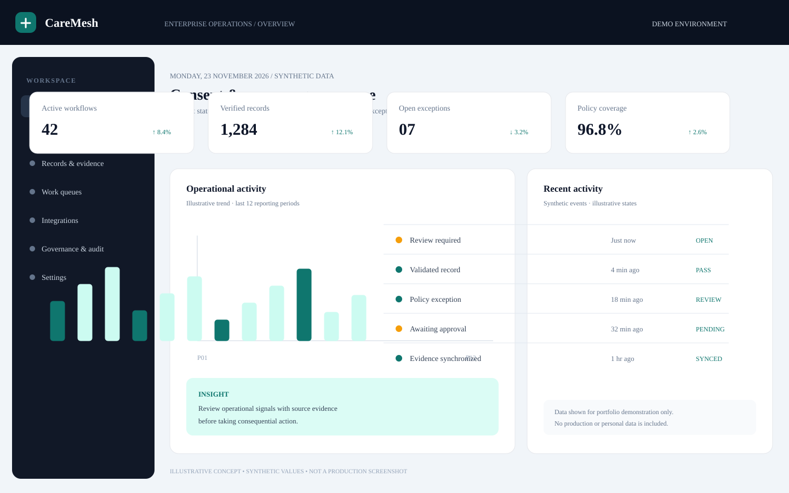
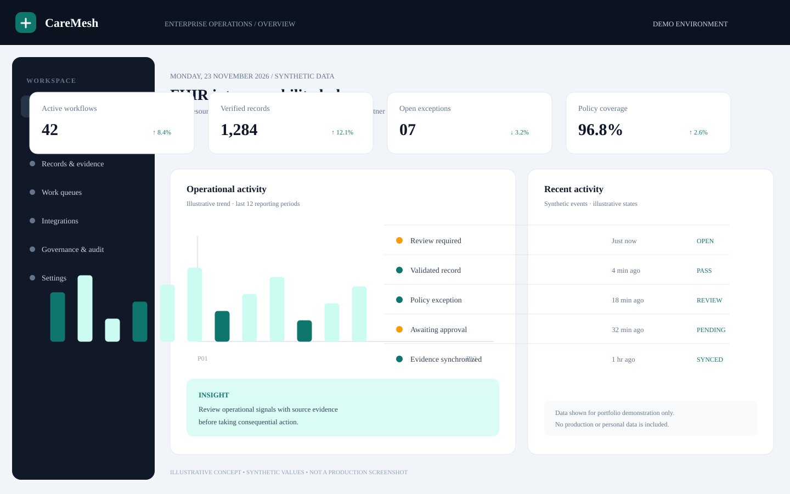

# CareMesh

**Enterprise Healthcare Interoperability & Care Coordination Platform**

> A privacy-first architecture concept for consent-aware exchange, accountable coordination and trustworthy health information workflows.

[](https://github.com/matiur25580/CareMesh-Enterprise-Healthcare-Interoperability-Care-Coordination-Platform/actions/workflows/ci.yml)
[](https://github.com/matiur25580/CareMesh-Enterprise-Healthcare-Interoperability-Care-Coordination-Platform/actions/workflows/codeql.yml)
[](https://nodejs.org/)
[](https://www.typescriptlang.org/)
[](https://www.docker.com/)

---

## 1. Executive overview

CareMesh explores a modern, multi-tenant foundation for consent-aware health information exchange and care coordination. The long-term product direction connects organizational identity, purpose-of-use policy, interoperability contracts, referrals, accountable handoffs and audit evidence.

The current runnable milestone is deliberately limited: it provides tenant-aware authentication, a synthetic consent-purpose simulator, tenant-scoped decision history, API readiness checks and a React dashboard. It does **not** connect to an EHR, exchange FHIR resources, authorize access to clinical records or support real patient care.

<blockquote>
<strong>Safety boundary:</strong> CareMesh is a portfolio/development project, not a clinical system. Use synthetic data only. Never enter patient names, identifiers, PHI, clinical records or production exports.
</blockquote>

**Project status:** active engineering foundation / synthetic-data MVP. The dashboard gallery below contains illustrative UI concepts made with synthetic values; these are not screenshots of a live clinical deployment.

## 2. The problem

Healthcare delivery depends on multiple organizations, systems and teams. Fragmented identity, inconsistent consent interpretation and poorly observable handoffs can create operational risk. A trustworthy platform needs to answer:

- Which organization and authenticated actor is requesting an action?
- What purpose is being asserted, and is it permitted by the relevant consent?
- Is the consent active and within its validity window?
- Which policy version and decision rationale were applied?
- Can an access or coordination event be attributed and reviewed?
- Are data exchange contracts validated and privacy controls enforced?

CareMesh is designed around explicit trust boundaries, minimum-necessary data handling and explainable authorization—not unrestricted data aggregation.

## 3. Product capabilities and implementation status

### Available in this branch

- **Tenant-aware identity:** JWT authentication, organization-scoped user accounts and role-based authorization.
- **Synthetic consent evaluation:** rule-based evaluation of status, requested purpose, permitted purposes and validity window.
- **Decision history:** tenant-scoped history of simulator outcomes, actor, purpose, decision and reason codes.
- **Data minimization:** simulator history does not store subject references, patient identifiers or clinical payloads.
- **Operational controls:** rate-limited evaluation/login endpoints, strict Zod input validation and database readiness checks.
- **Container foundation:** multi-stage Docker build, non-root runtime and Compose-managed MongoDB.
- **Engineering controls:** automated tests, type checks, production builds, container image build, CodeQL workflow and Dependabot configuration.
- **Database index provisioning:** explicit idempotent index command for deployment workflows.

### Product roadmap — not represented as shipped functionality

- FHIR R4/R5 resource contracts, profile validation and terminology services.
- SMART on FHIR / OAuth 2.0 authorization flows and external identity federation.
- Patient identity matching and organization/provider directory.
- Consent lifecycle ingestion, provenance, versioning and revocation propagation.
- Purpose-of-use enforcement at each protected resource boundary.
- Referral orchestration, task ownership, transitions of care and escalation.
- Immutable audit event architecture, retention controls and privacy operations.
- Integration monitoring, data-quality workflows and standards-based partner adapters.

The current simulator evaluates a caller-supplied synthetic snapshot. It does not retrieve or validate a persisted consent record and must not be used as a real access-control decision.

## 4. Architecture

```text
React + TypeScript dashboard
          |
          | HTTPS / JSON + Bearer JWT
          v
Express + TypeScript API
  |       |        |
  |       |        +-- Zod input validation
  |       +----------- Authentication / role checks
  +------------------- Tenant-scoped service routes
          |
          v
       MongoDB
  users / synthetic evaluation history
```

### Technology stack

| Layer | Technology |
|---|---|
| Web | React 18, TypeScript, Vite |
| API | Node.js, Express 4, TypeScript |
| Validation | Zod |
| Persistence | MongoDB, Mongoose |
| Identity | bcrypt password hashing, short-lived JWT |
| Security middleware | Helmet, CORS allowlist, express-rate-limit |
| Testing | Vitest, Supertest, Testing Library |
| Delivery | GitHub Actions, CodeQL, Dependabot, Docker Compose |
| Interoperability direction | HL7 FHIR, SMART on FHIR, terminology services (roadmap) |

## 5. Privacy, security and safety model

- Tenant context is derived from the authenticated token on protected API operations.
- Protected routes apply role authorization at the service boundary.
- Passwords are stored as bcrypt hashes; access tokens are short-lived and use issuer/audience validation.
- Consent evaluation accepts a strict schema and rejects unexpected fields.
- Successful simulator evaluations are stored with actor, requested purpose, consent status, decision and reason codes.
- The simulator history deliberately excludes subject reference, patient identifier and clinical payload.
- API logs and error responses should not contain health data or secrets.
- A simulator result is **not** a legal consent ledger, a clinical decision, or an authorization to access an EHR.
- Never connect production clinical systems or load real patient data into this project.

### Database indexes

Production automatic index creation is disabled. Run the explicit index provisioning command as a controlled deployment/migration step using an environment with database access and index-creation privileges:

```bash
MONGODB_URI='mongodb://127.0.0.1:27017/caremesh' npm run db:indexes
```

The command provisions declared user, consent and synthetic evaluation indexes and exits non-zero if provisioning fails. Review index changes and database permissions before rollout.

## 6. Quick start

### Prerequisites

- Node.js 20 or newer and npm
- Docker Engine + Docker Compose (recommended for the complete local stack)
- A local MongoDB instance if not using Compose

### Option A — Docker Compose

Create a local-only secret and start the application:

```bash
printf 'JWT_SECRET=%s\n' "$(openssl rand -base64 48)" > .env
docker compose up --build -d
docker compose ps
docker compose logs -f app
```

Open **http://localhost:4100**. API health is available at `/api/health`; database readiness is available at `/api/health/ready`.

Stop the containers with `docker compose down`. The named MongoDB volume is preserved; use `docker compose down -v` only when intentionally deleting local database data.

### Option B — Run from source

```bash
cp .env.example .env
# Edit .env and replace JWT_SECRET with a random value of at least 32 characters.
npm install
npm run dev
```

In a second terminal:

```bash
npm run dev:web
```

Open **http://localhost:5174**. The Vite development server proxies API requests to port 4100.

### Provision a synthetic test account

After configuring MongoDB and the environment, create a synthetic-data-only account with the operator-only CLI:

```bash
npm run user:create
```

Use the CLI prompts; do not commit credentials or use real patient information.

## 7. Environment configuration

| Variable | Purpose | Example / requirement |
|---|---|---|
| `MONGODB_URI` | MongoDB connection string | Local URI in `.env.example`; production URI from secret manager |
| `PORT` | API listen port | `4100` |
| `HOST` | API bind interface | `0.0.0.0` in containers |
| `CORS_ORIGIN` | Allowed browser origin(s) | `http://localhost:5174` |
| `NODE_ENV` | Runtime mode | `development` or `production` |
| `JWT_SECRET` | JWT signing secret | Random secret, minimum 32 characters |

Never use the example JWT value outside local setup. Production requires a managed secret store, authenticated MongoDB with TLS, restricted network access, backups, monitoring and formal privacy/security review.

## 8. Run quality checks

```bash
npm test
npm run typecheck
npm run build
npm run db:indexes
```

The CI workflow runs tests, API/web type checks, production builds and a Docker image build. CodeQL runs on pushes, pull requests and a weekly schedule. Dependabot checks npm and GitHub Actions dependencies weekly.

**Verification boundary:** unit/API tests currently mock persistence where appropriate. A passing CI run does not prove live MongoDB integration, browser end-to-end behavior, FHIR conformance, clinical safety, regulatory compliance or production deployment readiness.

## 9. Dashboard concept gallery — 12 illustrative screens

The following twelve images are **illustrative UI concepts** created for product storytelling and design direction. They use synthetic sample values and are arranged in a single vertical column for easy review. They are not captures from a live clinical system and do not imply that every depicted module is implemented.

### 01 — Care coordination command center
An operational overview concept for cross-organization coordination, open handoffs, referral status and service signals. A future implementation should expose ownership and escalation context, not just aggregate counts.


### 02 — Patient identity resolution
A proposed identity-review workspace for candidate matching, confidence indicators and duplicate-resolution governance. Any real identity workflow would require strict authorization, human review and carefully controlled identifiers.


### 03 — Consent and purpose governance
A consent overview concept for status, permitted purpose, validity windows and exceptions. The current MVP implements a synthetic consent-purpose simulator, not a persisted consent lifecycle or production authorization service.



### 04 — FHIR interoperability hub
A future integration workspace for resource validation, partner endpoints, exchange status and error handling. FHIR profiles, terminology validation and actual exchange adapters remain roadmap capabilities.



### 05 — Referral management workspace
A coordination concept for referral ownership, receiving organization, status transitions and outstanding actions. A production workflow should include idempotency, escalation and accountable handoff history.


### 06 — Clinical access audit
A proposed review surface for attributable access events, policy context and investigation status. The current synthetic audit history records simulator activity only and is not a clinical access ledger.


### 07 — Care gap intelligence
A future coordination view for follow-up needs, care-gap ownership and prioritized outreach. It should be driven by validated, authorized data and should not autonomously make clinical decisions.


### 08 — Organization trust network
A partner-governance concept for organization identity, exchange relationships, trust status and integration readiness. Access should be explicitly scoped to approved organizational relationships.


### 09 — Patient record timeline
A conceptual longitudinal timeline for synthetic encounters, observations and transitions. No real patient record timeline is implemented; do not enter patient data into this demonstration.


### 10 — Interoperability data quality
A future data-quality workspace for validation failures, terminology mapping, completeness and provenance. Quality signals should be traceable to source system, profile and validation version.


### 11 — Security and privacy operations
A privacy operations concept for access anomalies, consent exceptions, review queues and incident context. A production implementation needs defined retention, alert triage and auditable response procedures.


### 12 — Referral performance analytics
An operational analytics concept for referral turnaround, closure rates, aging handoffs and partner-level performance. Metrics should be transparent about definitions, data freshness and cohort scope.


## 10. Repository map

```text
apps/
  api/                 Express API, models, middleware, routes and tests
  web/                 React dashboard and UI tests
scripts/
  create-user.ts       Synthetic account provisioning
  ensure-indexes.ts    Explicit database index provisioning
docs/
  assets/dashboard/    12 illustrative SVG dashboard concepts
.github/
  workflows/           CI and CodeQL workflows
  dependabot.yml       Dependency update policy
Dockerfile
docker-compose.yml
```

## 11. Engineering principles and next milestones

1. Establish formal data classification, privacy impact assessment and threat model.
2. Define FHIR resource/profile contracts and validate them against published test suites.
3. Implement SMART on FHIR / OAuth 2.0 and external identity federation.
4. Build consent lifecycle ingestion with provenance, versioning and revocation propagation.
5. Enforce purpose-of-use decisions at every protected resource boundary.
6. Add referral workflow orchestration, durable eventing and idempotent integration patterns.
7. Introduce immutable audit architecture, retention policy and incident response runbooks.
8. Add live MongoDB integration tests, browser E2E tests, backup/restore exercises and operational observability.

## 12. Responsible use and disclosure

CareMesh is a software engineering portfolio project, not a medical device, clinical decision support system or production healthcare interoperability service. No legal, regulatory, security certification, FHIR conformance or clinical validation is claimed. Use synthetic data only. Do not connect real EHR systems or upload PHI. See [SECURITY.md](SECURITY.md) for responsible vulnerability disclosure and [CONTRIBUTING.md](CONTRIBUTING.md) for contribution expectations.

## 13. License

No open-source license is granted unless a license file is present in this repository. All rights are otherwise reserved.
